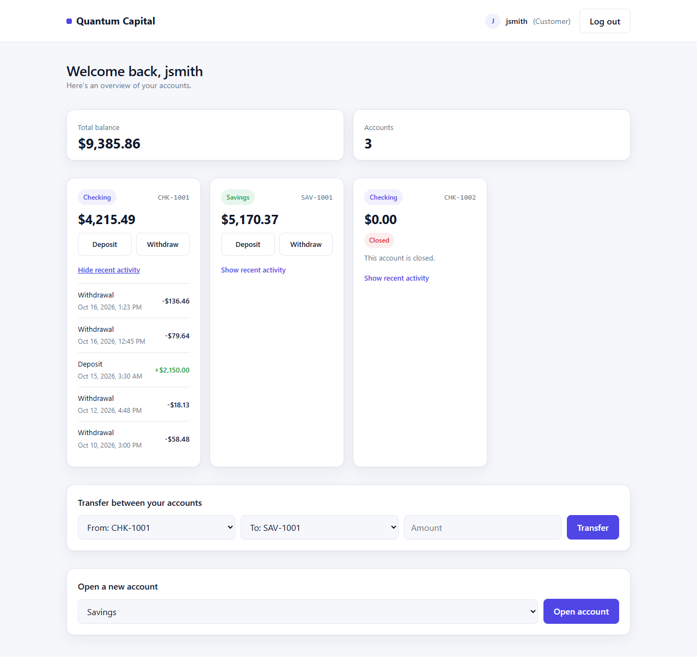
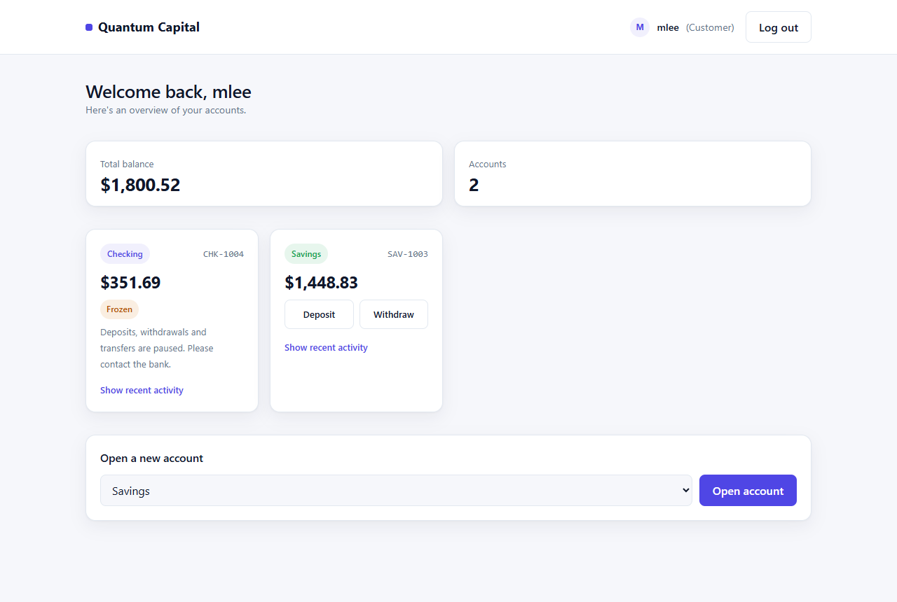
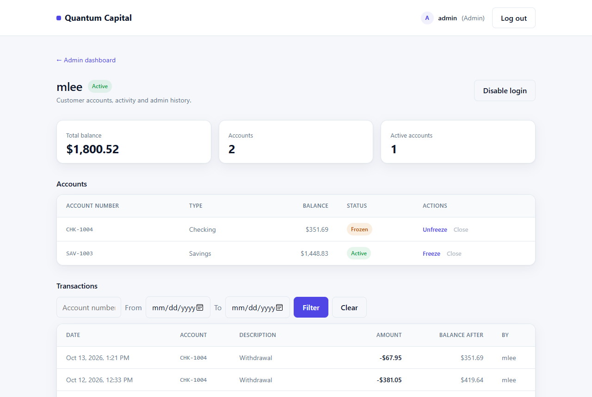
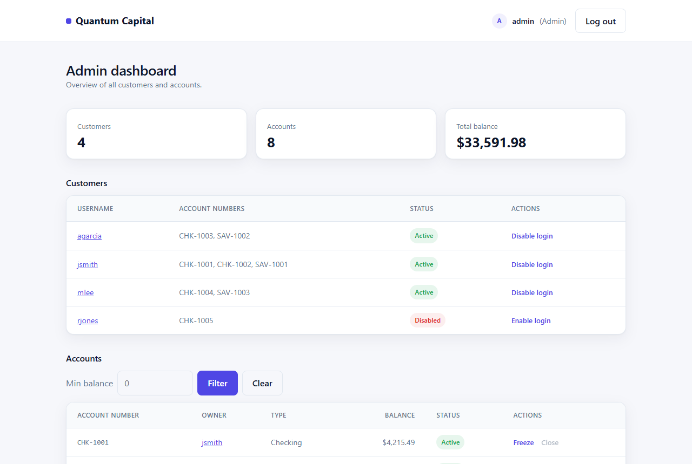
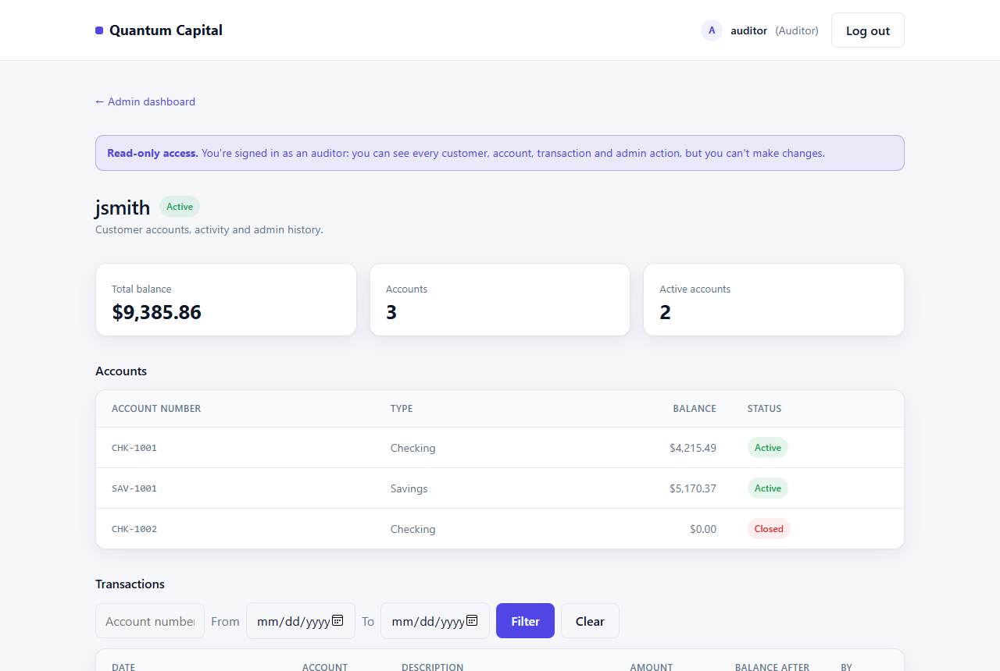
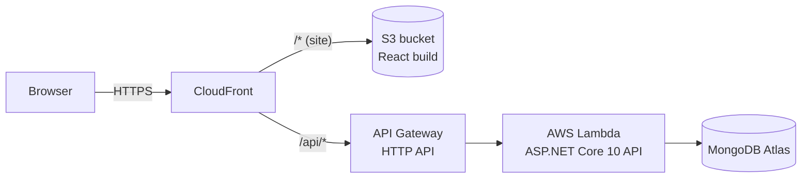

# Quantum Capital

[](https://github.com/fraze-dev/quantum-capital-bank/actions/workflows/ci.yml)

A full-stack banking app: an **ASP.NET Core 10** REST API and a **React + TypeScript** frontend, backed by **MongoDB Atlas** and deployed serverless on **AWS** (Lambda, API Gateway, S3 and CloudFront, defined as code with SAM).

Customers can open accounts, move money and see their history. Staff can investigate customers, freeze or close accounts and disable logins, with every action recorded in an audit log.

**Live demo: https://d168fzbhwdwvz0.cloudfront.net**

| Try it as | Username | Password |
|---|---|---|
| A customer | `jsmith` | `pass123` |
| A customer with a frozen account | `mlee` | `pass789` |
| Read-only staff (auditor) | `auditor` | `auditor123` |

The login page has these as one-click buttons. The first request after a quiet spell can take a couple of seconds while the Lambda function starts.



## Features

**Customers**
- Checking and savings accounts: open accounts, deposit, withdraw, transfer between your own accounts
- Rules enforced by the API: savings can't be overdrawn, checking can go up to $100 overdrawn, amounts must be positive with at most two decimal places
- Recent activity on every account, with each entry's resulting balance

**Staff**
- Dashboard of all customers and accounts, with balance filtering and a searchable transaction history (by customer, account and date range)
- A detail page per customer: their accounts, transactions and the admin actions taken on them
- **Freeze, unfreeze or close accounts** and **disable customer logins**, each with a required reason. Accounts are never deleted, so their history stays available for reporting.
- An **audit log** of every admin action: who, when, what changed and why
- A read-only **Auditor** role that can see everything but change nothing (the public demo's staff login)

| Customer with a frozen account | Staff view of a customer |
|---|---|
|  |  |
| **Admin dashboard** | **Read-only auditor** |
|  |  |

## Architecture



One CloudFront distribution serves both the site and the API, so the browser sees a single HTTPS origin: no CORS in production, and the S3 bucket stays private (only CloudFront can read it). Everything above is defined in [`template.yaml`](template.yaml) and deployed by [`deploy.ps1`](deploy.ps1).

## How it works

The parts that matter most in a banking app, and how they're handled:

**Authentication and authorization.** Login returns a signed JWT (HS256, one hour). Every endpoint requires one unless explicitly marked public, and the API only trusts the identity inside the token, never a username sent in a request body. Customers can only reach their own data; staff roles are checked per endpoint. Each request also re-checks the user's status, so disabling a customer cuts off a session they already have open. Passwords are stored as salted PBKDF2 hashes (ASP.NET Core Identity's `PasswordHasher`), and the admin password comes from configuration, not source code.

**Money movement that can't race or half-complete.** A withdrawal is a single conditional database update: "subtract this amount if the account is active and the balance stays within its overdraft limit". Two simultaneous withdrawals can't both pass the check, and a freeze can't slip in between check and update. The balance change and its ledger entry are written in one MongoDB transaction, as are both sides of a transfer, so they're saved together or not at all. Account numbers come from an atomic counter.

**An append-only ledger.** Every deposit, withdrawal and transfer leg is recorded with its signed amount and the balance after it. Entries are never edited or deleted, and each account's history sums to its balance (the tests check this).

**Statuses instead of deletes.** Accounts move between Active, Frozen and Closed (closing requires a $0.00 balance and is final); customers between Active and Disabled. Each change and its audit entry are written in the same transaction.

**Schema changes without downtime.** Data migrations run at startup and are recorded so each runs once; for example, giving pre-ledger accounts an opening-balance entry, and hashing passwords that an early version had stored as plain text.

## Tests

```
dotnet test BankApp.slnx
```

75 tests: unit tests for password hashing, tokens, money formatting and the account status rules, and integration tests that start the real API in memory against a throwaway MongoDB (via [Testcontainers](https://dotnet.testcontainers.org/), so Docker must be running). They cover the access rules, overdraft limits to the cent, transfer rollback, freezing and disabling, the audit log, and 20 simultaneous withdrawals never exceeding the limit.

[CI](.github/workflows/ci.yml) runs the full suite plus a frontend lint and build on every push and pull request.

## Tech stack

| | |
|---|---|
| **API** | C#, ASP.NET Core 10, MongoDB .NET driver, JWT bearer auth |
| **Frontend** | React 19, TypeScript, Vite, React Router |
| **Data** | MongoDB Atlas (replica set, for transactions) |
| **Hosting** | AWS Lambda (.NET 10, arm64), API Gateway HTTP API, S3, CloudFront |
| **Infrastructure** | AWS SAM / CloudFormation |
| **Testing and CI** | xUnit, WebApplicationFactory, Testcontainers, GitHub Actions |

## Project structure

```
BankApi/                 ASP.NET Core API
  src/Controllers/       HTTP endpoints: routing, permission checks, validation
  src/Dtos/              Request and response shapes
  src/Models/            MongoDB documents (users, accounts, ledger, audit log)
  src/Repositories/      Data access, startup migrations, demo data
  src/Services/          Business rules: money movement, statuses, users, tokens
BankApi.Tests/           Unit and integration tests
frontend/                React + TypeScript single-page app
template.yaml            AWS infrastructure (SAM)
deploy.ps1               Test, build and deploy everything
```

## Running locally

Prerequisites: .NET 10 SDK, Node.js 22 or later, a MongoDB replica set (a free MongoDB Atlas cluster works), and Docker for the integration tests.

1. Store the API's secrets with .NET user-secrets (kept outside the repo):
   ```
   dotnet user-secrets set "MongoDb:ConnectionString" "mongodb+srv://..." --project BankApi
   dotnet user-secrets set "Jwt:SigningKey" "<any random string of 32+ characters>" --project BankApi
   dotnet user-secrets set "Seed:AdminPassword" "<a password for the admin login>" --project BankApi
   ```
2. Start the API. Locally it uses a `BankApiDb-dev` database, which is filled with demo data on first start.
   ```
   dotnet run --project BankApi --launch-profile http
   ```
3. Start the frontend, then open http://localhost:5173:
   ```
   cd frontend
   npm ci
   npm run dev
   ```

To reload the demo data at any time: `dotnet run --project BankApi --launch-profile http -- reset-demo-data --yes`

## Deploying

`.\deploy.ps1` runs the tests, deploys the API stack with SAM, builds the React app, uploads it to S3 and clears the CloudFront cache. It needs the AWS CLI (configured with deploy credentials), the AWS SAM CLI, and the secrets above. They're passed to the stack as hidden (`NoEcho`) parameters, so none are stored in the repo.

## How this project grew

The project started as a console app and was rebuilt in stages. Each stage is tagged:

- [`v1-console`](../../tree/v1-console): an object-oriented console banking app (users, accounts, an in-memory bank)
- [`v2-in-memory-api`](../../tree/v2-in-memory-api): the same domain as an ASP.NET Core REST API
- [`v3-mongodb-api`](../../tree/v3-mongodb-api): the API backed by MongoDB
- `main`: the full-stack app, deployed to AWS, with JWT auth, an atomic ledger, account statuses, an audit log, staff roles and automated tests
